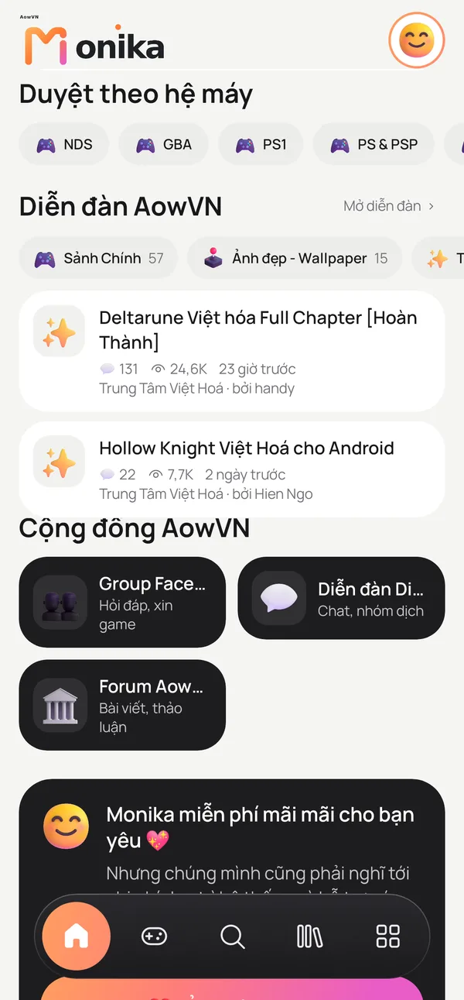

# AowVN Monika

App Android "tất cả trong một" cho cộng đồng [aow.vn](https://www.aow.vn): đọc bài viết, nhận thông báo bài mới, tải game và chơi ngay trong app.

## Hệ máy hỗ trợ

- **Chạy trong app:** NDS, GBA, GBC, PS1, PSP, 3DS, RPG Maker (2000/2003, XP/VX/Ace), Kirikiri, Java (J2ME).
- **Chạy dạng web:** Flash, RPG Maker MV/MZ, TyranoScript, ONScripter.
- **App ngoài:** Ren'Py (JoiPlay).

Chi tiết từng máy, lõi và giới hạn: [docs/PHAT-TRIEN.md](docs/PHAT-TRIEN.md).

## Tải và cập nhật

- Bản phát hành (APK): [trang Releases](https://github.com/aowvn-10diem/aowvn-monika/releases).
- Tin tức và hướng dẫn: [aow.vn](https://www.aow.vn).

## Cộng đồng

Tham gia cộng đồng và đọc bài mới tại [aow.vn](https://www.aow.vn).

## Giấy phép

GPL-3.0 (do dùng [LibretroDroid](https://github.com/Swordfish90/LibretroDroid), GPL-3.0). Khi phát hành APK phải công khai mã nguồn.

Mã nguồn tương ứng với mỗi APK có trong repo này.
